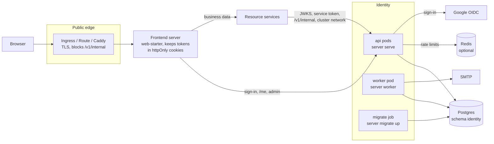
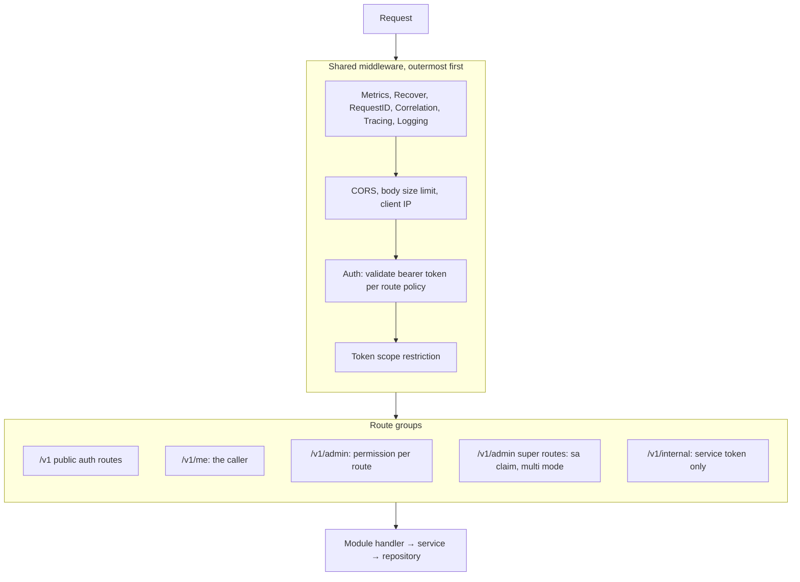
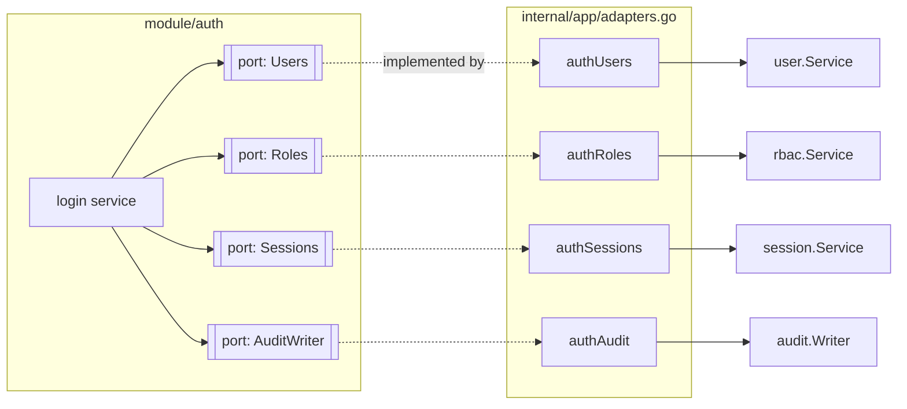
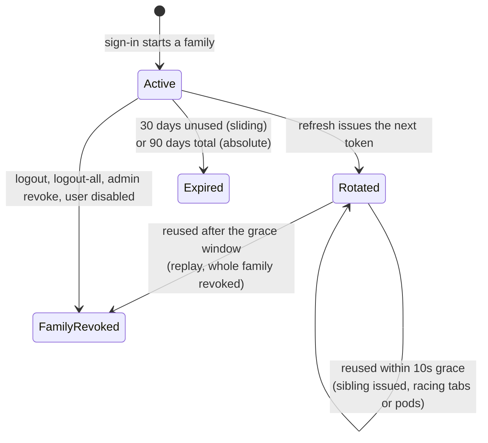
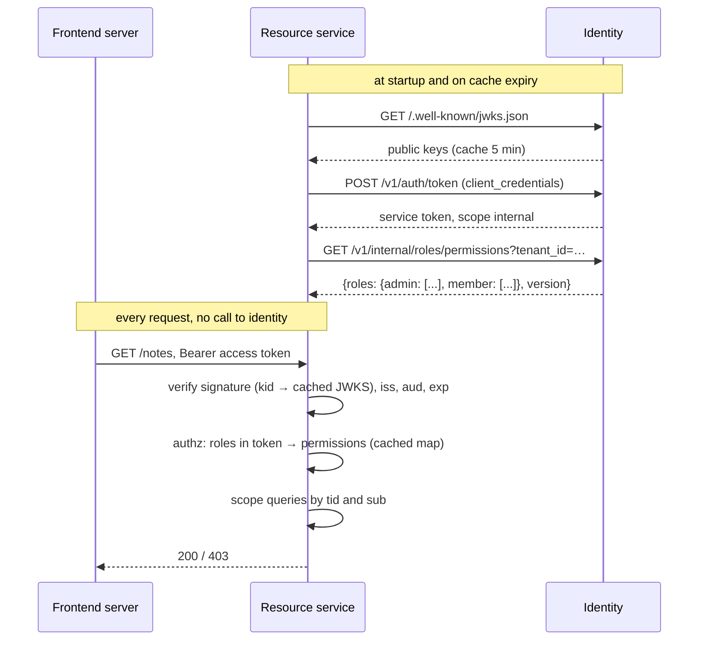
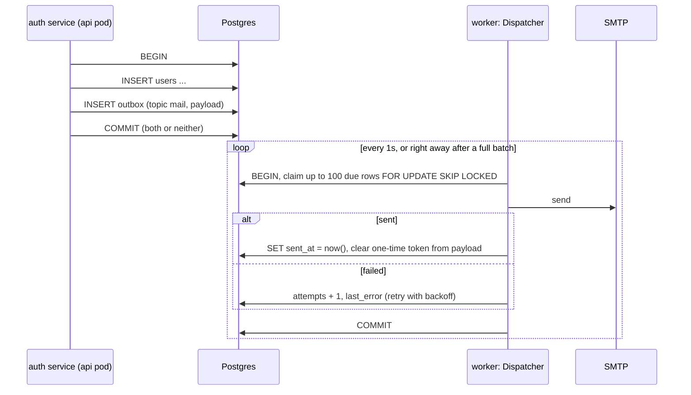

# Architecture

This is the map of go-identity for an engineer new to it. It explains how the service is deployed, how a request
moves through it, how the modules fit together, how resource services use it, and the patterns the code repeats.
Read it before the code. Each section names the files to open when you need more detail.

Related documents:

- [README](../README.md) gets it running.
- [CONTRIBUTING](../CONTRIBUTING.md) and [AGENTS](../AGENTS.md) are the rules for changes.
- [PATTERNS](PATTERNS.md) has copy-paste code for the patterns below.
- [DECISIONS](DECISIONS.md) records why things are the way they are.
- The specs (PRD, TRD, APP_FLOW) live in the project's `phase2/backend/` folder. When this page and the TRD
  disagree, the TRD wins.

## Contents

1. [What identity is](#1-what-identity-is)
2. [Deployed system](#2-deployed-system)
3. [Inside one request](#3-inside-one-request)
4. [Modules and how they talk](#4-modules-and-how-they-talk)
5. [Tokens, sessions and keys](#5-tokens-sessions-and-keys)
6. [Integrating a resource service](#6-integrating-a-resource-service)
7. [Patterns](#7-patterns)
8. [Where to look in the code](#8-where-to-look-in-the-code)

## 1. What identity is

Identity is where users sign in, and it is the only service that issues tokens. Your other services (**resource
services**) trust its tokens and never handle passwords. It owns:

- **Sign-in:** password and Google, sign-up, email verification, password reset and invites.
- **Sessions:** short-lived access tokens (JWT, RS256) and rotating refresh tokens.
- **Access control:** users, tenants, roles and permissions, and the admin API that manages them.
- **Audit:** a log of every security-relevant change.

Terms used throughout:

| Term | Meaning |
|---|---|
| Tenant | An organisation. `single` mode has exactly one (`default`). `multi` mode has many, created by the super admin |
| Membership | A user's link to a tenant (`tenant_members`), with its own status. One user can belong to several tenants |
| Role / permission | A role belongs to one tenant and grants permission keys such as `notes:read`. A user's permissions in a tenant are the union of their roles' permissions |
| Super admin | Exactly one account. It holds every permission in every tenant (token claim `sa: true`) and is managed only from the CLI |
| Family | One chain of refresh tokens, one per signed-in device. Revoking the family signs that device out |
| Service client | A resource service with a client ID and secret, which lets it call identity's `/v1/internal` API |

## 2. Deployed system

One image and one binary (`cmd/server`) run as three processes:

| Process | Command | Runs | Scaling |
|---|---|---|---|
| API | `serve` | The HTTP API | Stateless. Run 2 or more (Helm defaults to 2, autoscales to 6) |
| Worker | `worker` | The outbox dispatcher (sends mail) and the cleanup job | 1 is enough. More are safe, because rows are claimed with `FOR UPDATE SKIP LOCKED` |
| Migrate | `migrate up` | Applies the embedded SQL migrations, then exits | Once per release, before the new API starts |

Why it scales without coordination:

- **No state in the pods.** Sessions, one-time tokens and OAuth state live in Postgres. Every pod loads the same
  signing keys from a mounted secret, so any pod can sign and verify.
- **Postgres is the one hard dependency.** `/readyz` fails when the database leader is unhealthy.
- **Redis is optional.** It only shares rate-limit counters between pods. Without it the limits are per pod and a
  warning is logged. Redis is never a readiness check, so a Redis outage does not take sign-in down. The limiter
  fails open, and the per-account lockout still bounds password guessing.
- **Resource services don't call identity per request.** They verify tokens with cached public keys, so identity
  is off their hot path (section 6).

### Deployment targets

| | Kubernetes (Helm) | Single VPS (Compose) |
|---|---|---|
| Files | [deploy/helm/identity](../deploy/helm/identity) | [deploy/compose/docker-compose.yaml](../deploy/compose/docker-compose.yaml), `--profile vps` |
| Migrations | `pre-install` / `pre-upgrade` hook Job | `migrate` service. `api` and `worker` wait for it |
| Edge | Ingress or OpenShift Route. `route.blockInternalPath` denies `/v1/internal` | Caddy (automatic TLS), answers 404 on `/v1/internal` |
| Signing keys | `signingKeys.existingSecret`, mounted read-only | `./keys` mounted read-only |
| Extras | HPA, PodDisruptionBudget, ServiceMonitor | Daily `pg_dump` into the `backups` volume |

Identity and the resource services can share one Postgres database, each with its own schema (`identity`, `app`).
[deploy/sql/bootstrap.sql](../deploy/sql/bootstrap.sql) creates the `identity` role and schema once per environment,
and the app connects as that role. Either side can move to its own database later.

### Startup

`serve` does these steps in order, and refuses to start if any of them fails:

1. Load config ([config/config.yaml](../config/config.yaml) plus environment variables) and validate every section.
2. Check the schema is current. The API never migrates. It fails fast if the `migrate` job hasn't run.
3. Build the shared dependencies (database, rate limiters, outbox, the database-backed authorizer), then the modules.
   The `auth` module loads the signing keys here, so a pod that cannot sign tokens never starts.
4. **Bootstrap**, in one transaction and idempotent, because every pod runs it on every start. It syncs the permission catalog from config, seeds role templates (multi mode), records the signing-key metadata, ensures the
   default tenant exists, seeds the configured roles, and creates the super admin on the very first start
   ([internal/app/bootstrap.go](../internal/app/bootstrap.go)).
5. Mount the middleware and routes, then serve. On shutdown it waits `drain_delay`, then drains in-flight requests.

## 3. Inside one request

- **Route policy.** Every route needs a token unless [config/config.yaml](../config/config.yaml) `auth.rules` lists
  it as public (login, register, refresh, JWKS, health and so on). Identity checks its own tokens the way a resource
  service would, through its own JWKS.
- **Scoped tokens.** A token with a `scope` claim can call only the routes listed for that scope in
  [internal/app/routes.go](../internal/app/routes.go). `password_change` allows only `POST /v1/me/password`, for the
  forced change at first sign-in. `internal` allows only the `/v1/internal` routes.
- **Admin permissions come from the database, not the token.** Admin routes use the `rbac` authorizer, which reads
  the caller's current grants once per request (`rbac.Memoize`). If an admin loses a role or is disabled, the change
  applies immediately, without waiting 15 minutes for the token to expire.
- **Groups are built once.** `internal/app/routes.go` creates the groups and their middleware. Modules only mount
  routes into them (`rt.API`, `rt.Me`, `rt.Admin`, `rt.Super`, `rt.Internal`, `rt.Root`).
- **Inside a module** the layers are `handler` → `service` → `repository`, with no upward imports. Handlers return
  errors with an `errorz` code, and `httpx.Handle` turns them into the standard error envelope with the right status.

## 4. Modules and how they talk

Each module in `internal/module/<name>` is one feature boundary and owns its own tables:

| Module | Owns | Tables | Mounts |
|---|---|---|---|
| `auth` | Every sign-in flow, token issuing, signing keys, one-time tokens, Google OIDC and account links, service tokens | `identities`, `one_time_tokens`, `oauth_states`, `signing_keys` | `/.well-known/jwks.json`, `/v1/auth/*` |
| `session` | Refresh-token families: issue, rotate, revoke, list devices | `refresh_tokens` | `/v1/me/sessions`, admin revoke |
| `user` | Accounts, profile, passwords, email encryption, admin user management, the super admin | `users`, `credentials` | `/v1/me`, `/v1/admin/users`, `/v1/internal/users/{id}` |
| `tenant` | Tenants and memberships, tenant onboarding | `tenants`, `tenant_members` | `/v1/admin/tenants` (super), `/v1/internal/tenants/{id}` |
| `rbac` | Permission catalog, roles, role templates, role assignment, the admin authorizer | `permissions`, `roles`, `role_permissions`, `user_roles` | `/v1/admin/roles`, `/v1/admin/permissions`, templates, `/v1/internal/roles/permissions` |
| `audit` | The append-only audit log | `audit_log` | `/v1/admin/audit` |

`auth` never touches `users` or `credentials` directly: it reads and changes accounts and password hashes through
its `Users` port, which the `user` module serves.

Shared code that holds no identity rules lives in `internal/platform`: database and outbox, HTTP helpers, list
queries, tenant scope, API error reasons, mail, rate limiting, cleanup, and the test kit. `internal/app` wires it
all together. Neither contains business logic, so both can move into the service template later.

### No module imports another

This is the most important structural rule, and `internal/app/arch_test.go` enforces it in `make test`. When one
module needs another's data, it declares a small interface (a **port**) in its own `ports.go`. Then `internal/app`
implements that port with a thin **adapter** that calls the other module's service:

Who depends on whom, through ports (all wired in [internal/app/module.go](../internal/app/module.go)):

| Consumer | Uses |
|---|---|
| `auth` | `user` (accounts, passwords), `tenant` (memberships, invites), `rbac` (role names, permissions, grants), `session` (refresh tokens), `audit` |
| `user` | `tenant` (memberships), `rbac` (roles of users, last-admin guard), `session` (revoke on disable), `audit` |
| `session` | `tenant` (is the caller still a member), `audit` |
| `tenant` | `audit`, plus the one back edge: `rbac` and `auth` for onboarding |
| `rbac` | `audit` |

**The one back edge.** Creating a tenant copies the template roles (`rbac`) and invites the first admin (`auth`), but
`auth` itself depends on `tenant`. So `tenant` gets its `Onboarding` port through `SetOnboarding` after every module
is built, not through `New`.

**Startup work that spans modules** (default tenant, role seeding, super admin) lives in `internal/app/bootstrap.go`,
which calls each module's service in turn. No module reaches into another to do it.

### Transactions cross ports

A port call is a plain Go call with the same `ctx`. `database.WithTx` puts the transaction on the context, and
every repository runs on the context's transaction when there is one. One service can therefore make writes in
several modules atomic. For example, when an admin disables a user, four writes commit or roll back together: the
membership change (`tenant`), guarded by the last-admin check (`rbac`), the session revocation (`session`) and the
audit row (`audit`). All of it runs from one `user` service method ([internal/module/user/admin.go](../internal/module/user/admin.go)).

## 5. Tokens, sessions and keys

### Access token

A JWT signed with RS256, valid for 15 minutes (`modules.auth.token.access_ttl`). The claims are chosen so go-sdk
`auth` reads them with no mapping:

| Claim | Meaning |
|---|---|
| `iss`, `aud` | `identity`, `["api"]`. Resource services check both |
| `sub` | The user ID |
| `tid` | The tenant ID. Always present, the default tenant in single mode |
| `roles` | Role names in this tenant |
| `perms` | Permission keys, only when `token.claims: roles_and_permissions` |
| `sa` | `true` for the super admin only |
| `sid` | The refresh-token family, so `/v1/me/sessions` can mark the current device |
| `scope` | Only on restricted tokens: `password_change` or `internal` |
| header `kid` | Which signing key, matched against JWKS |

Roles and permissions are read from the database every time a token is issued. A role change therefore shows up at
the user's next refresh, at most 15 minutes later. `POST /v1/admin/users/{id}/revoke-sessions` forces it sooner.

### Refresh tokens and rotation

A refresh token is 256 random bits, opaque (not a JWT), and stored only as a SHA-256 hash. Every use rotates it
([internal/module/session/service.go](../internal/module/session/service.go)):

The rotation locks the token's row, so two pods racing to rotate the same token run one after the other. Reuse
after the grace window means someone replayed a stolen token, so the whole family is revoked and that device must
sign in again.

### Signing keys and JWKS

Private keys are PEM files in a mounted secret, one per `kid`. A `keys.yaml` file marks each key `next`, `active`,
`retiring` or `retired`. `GET /.well-known/jwks.json` publishes the public keys of the next, active and retiring
keys, cached for 5 minutes. The database stores only key metadata (`signing_keys`), never anything that can sign.
Rotating a key signs no one out, because refresh tokens are not JWTs. The procedure is in the
[key rotation runbook](runbooks/key-rotation.md).

### Sign-in flows at a glance

- **Password:** `POST /v1/auth/login` returns a token response. In multi mode, a user in several tenants gets a
  tenant list to choose from instead. An account flagged `must_change_password` (the super admin at first sign-in,
  or after `superadmin reset`) gets a short-lived `password_change` token and no refresh token.
- **Google:** `GET /v1/auth/google/start` redirects to Google, using PKCE with `state` and `nonce` stored hashed in
  `oauth_states`. Google redirects back to `/v1/auth/google/callback`, which sends the browser to the frontend with a
  one-time code. The frontend server trades the code for tokens with `POST /v1/auth/exchange`, so tokens never
  appear in a URL.
- **Refresh:** `POST /v1/auth/refresh` with the refresh token in the body.

Each flow, with its state machine, is described step by step in APP_FLOW.

## 6. Integrating a resource service

A resource service needs three things from identity: keys to verify tokens, a role-to-permission map, and sometimes
user or tenant details. [test/e2e/sampleresource](../test/e2e/sampleresource/notes.go) is a working example,
built on go-sdk alone.

What to configure on the resource service:

1. **Verify tokens** with go-sdk `auth`: RS256, `jwks_url` set to identity's `/.well-known/jwks.json`, issuer
   `identity`, audience `api`. The JWKS client refetches when it sees an unknown `kid`, so key rotation needs no
   restart.
2. **Check permissions** with go-sdk `authz`, using one of the sources in the table below. The `sa` claim always
   passes. Wildcards (`*`, `notes:*`) work in grants, not in checks.
3. **Register as a service client** (only for the `identity` source or the internal lookups). Add
   `{id, secret_hash}` to identity's `modules.auth.service_clients`. The hash is the argon2id PHC string of the
   secret. The service then trades the ID and secret at `POST /v1/auth/token` for a short-lived `scope: internal`
   token.
4. **Scope every query** by the token's `tid`, never by a request parameter, and by `sub` for owner checks. A
   permission ending in `:any` (`notes:read:any`) means "every row in the tenant", not just your own.

Permission sources for `authz`:

| Source | How | Trade-off |
|---|---|---|
| `identity` (default) | Fetches the role map from `/v1/internal/roles/permissions` with a service token, cached (`cache_ttl`, default 60s) | Small tokens. Admin role edits show within `cache_ttl`. If identity is down, the cached map is served stale for up to 10 × `cache_ttl`, then checks fail with 503 |
| `token` | Reads the `perms` claim. Identity must set `token.claims: roles_and_permissions` | No network call. Bigger tokens, and changes show only at the next refresh |
| `config` | A fixed role map in the service's own config | For services with fixed roles |

The internal API is meant for service-to-service calls only. The public edge blocks `/v1/internal` (Caddy answers
404, and the Helm ingress or Route denies it), so resource services reach it over the cluster or Compose network:

| Endpoint | Returns |
|---|---|
| `GET /v1/internal/roles/permissions?tenant_id=` | `{tenant_id, roles: {name: [keys]}, version}` |
| `GET /v1/internal/users/{id}` | `{id, display_name, status}` (no email) |
| `GET /v1/internal/tenants/{id}` | `{id, slug, name, status}`, for blocking a suspended tenant sooner than token expiry |

Identity can also run inside a host binary instead of as a separate service. See [identity.go](../identity.go) and
[examples/monolith](../examples/monolith/main.go). The host passes its own database and chi router, and identity's
routes mount alongside the host's.

## 7. Patterns

Each pattern solves one recurring problem. [PATTERNS.md](PATTERNS.md) has the code to copy.

### Transactional outbox: side effects that never get lost or sent by mistake

**Problem.** A sign-up must create the user and send a verification email. If the code sends the email and then
the transaction fails, the user gets a link to an account that doesn't exist. If it commits and then sending fails,
the user never gets the email.

**Solution.** The service writes the email as an `outbox` row inside the same transaction as the change
(`mail.Queue` → `Outbox.Enqueue`). A rollback drops the row, and a commit keeps it. The worker then delivers it.

The details that matter ([internal/platform/database/outbox.go](../internal/platform/database/outbox.go),
[internal/platform/mail/queue.go](../internal/platform/mail/queue.go)):

- **Several workers are safe.** `FOR UPDATE SKIP LOCKED` hands each row to one dispatcher, and the row stays locked
  until its outcome is recorded.
- **Retries back off** exponentially (1s, 2s, 4s, and so on) from the row's creation time, capped at about 17
  minutes per step.
- **Delivery is at least once.** A crash after sending but before recording the send resends the email, so senders
  must tolerate duplicates.
- **Expiry.** A payload with `expires_at` (a reset link that has expired) is marked `expired` and never sent.
- **No live secrets left behind.** After delivery the one-time token is cleared from the stored payload, in the same
  transaction. The row key is the recipient's hash, not the address.
- **A topic routes to a sender** registered in `senders()` ([internal/app/worker.go](../internal/app/worker.go)).
  Today the only topic is mail. A new side effect, such as a queue publish, adds a topic and a sender.
- **Production guard.** Without `SMTP_HOST`, mail is only logged, and the worker refuses to start in production
  rather than print one-time tokens to its logs.

### Audit in the same transaction

`audit.Writer.Write` runs on the context's transaction, so an audit row commits or rolls back together with the
change it describes. The request ID and the caller's IP come from the context. Audit rows have no gaps and never
describe a change that didn't happen.

### Ports and adapters between modules

See section 4. A consumer declares the small interface it needs, and `internal/app/adapters.go` connects it to the
real service. Modules stay independently testable with small fakes, and the dependency graph stays visible in one
file.

### Advisory locks for "only one at a time" rules

Some rules span rows that a plain `UPDATE` can't protect. Examples: a tenant must keep at least one user with
`roles:manage`, and only one super admin may exist. These code paths take a transaction-scoped Postgres advisory
lock first (`database.LockXact`), so two concurrent requests, or a CLI command racing a pod's boot, run one after
the other ([internal/platform/database/lock.go](../internal/platform/database/lock.go)).

### Optimistic locking and intent updates

Editable aggregates (such as roles) carry a `version`. Clients send it in `If-Match`, the `UPDATE` checks it, and a
stale version returns 409, so two admins can't silently overwrite each other. Updates name the columns they change
(`SetDisplayName`, `UpdatePasswordHash`) instead of saving a whole struct, so a write never resets a field it didn't
mean to touch.

### Tenant isolation

Every tenant-owned row has a `tenant_id`. Every query filters on it, and the tenant always comes from the token's
`tid` (through `internal/platform/scope`), never from the request. A missing tenant in the context is an error, not
"all tenants". `test/isolation` has cross-tenant tests.

### Secrets and PII at rest

- **Emails** are encrypted with AES-256-GCM, and lookups go through a keyed blind index (`email_hash`). Encryption
  happens inside the user repository, so services only see plain values.
- **Passwords** are hashed with argon2id. The parameters are stored with the hash, so a hash below the current
  parameters is rehashed at the next sign-in.
- **Refresh tokens, one-time tokens and OAuth state** are stored only as SHA-256 hashes. The raw value exists only
  in the response or the email.
- **Logs** never contain tokens, passwords, emails or request and response bodies.

### Cleanup

The worker runs [internal/platform/cleanup](../internal/platform/cleanup/cleanup.go) once a day. It deletes
expired OAuth states, spent one-time tokens, dead refresh tokens and old outbox rows past their retention window.
It deletes in bounded batches with `SKIP LOCKED`, so it never holds long locks and several workers are safe.

### Idempotent bootstrap

Startup steps run on every pod at every start, inside one transaction, and each finds its own earlier work and
leaves it alone (section 2). Pods can start in any order and several at once.

## 8. Where to look in the code

| Question | Open |
|---|---|
| How is the service wired? | [internal/app/app.go](../internal/app/app.go) (`build`), [internal/app/module.go](../internal/app/module.go) |
| What does module X need from others? | `internal/module/<x>/ports.go`, [internal/app/adapters.go](../internal/app/adapters.go) |
| Which routes need which token? | [config/config.yaml](../config/config.yaml) `auth.rules`, [internal/app/routes.go](../internal/app/routes.go) |
| What does an endpoint accept and return? | [api/openapi.yaml](../api/openapi.yaml), or Swagger UI at `/swagger/index.html` |
| How does a sign-in work? | `internal/module/auth/login.go`, `refresh.go`, `google.go`, `issue.go` |
| What runs in the background? | [internal/app/worker.go](../internal/app/worker.go) |
| What does the schema look like? | [migrations/](../migrations) |
| How does a resource service plug in? | [test/e2e/sampleresource](../test/e2e/sampleresource/notes.go), [test/e2e/README.md](../test/e2e/README.md) |
| How do I operate it? | [docs/runbooks](runbooks) |
